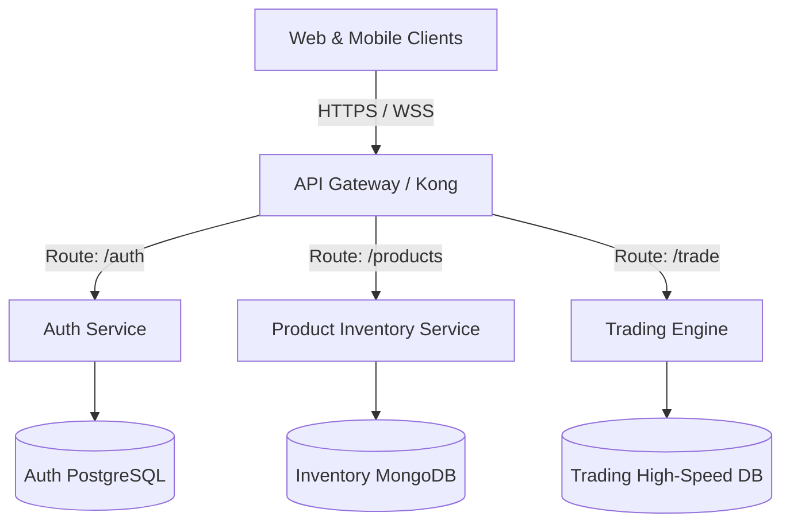
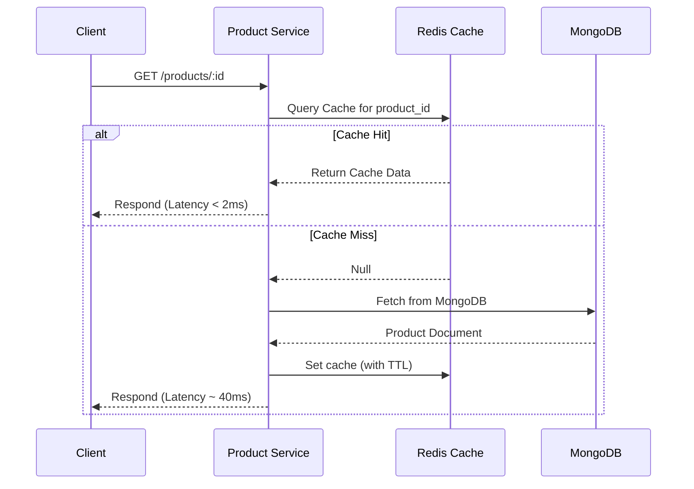
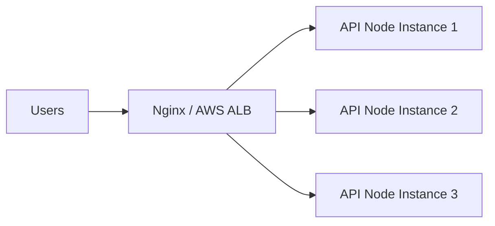

# Backend Scalability Design Notes 📈

To support millions of active traders and handle real-time asset tracking in Web3 space, our backend architecture can scale beyond a monolithic instance by implementing the following strategic designs:

---

## 🗺️ 1. Architecture: Monolith to Microservices
As PrimeTrade.ai grows, the backend can be split into dedicated, autonomous services:
- **Authentication Service**: Handles user sessions, JWT issuance, profile updates, and RBAC rules.
- **Product/Inventory Service**: Manages inventory catalog operations, stock locks, and listings.
- **Trading/Order Engine**: A high-performance, low-latency service designed to handle order books and asset swaps.

### Service Layout & API Gateway

* **API Gateway**: Implementing an API Gateway (like **Kong** or **AWS API Gateway**) acts as a single point of entry, handles token verification (JWT decoding at the edge), rate-limiting, and routes traffic to the correct microservice.

---

## ⚡ 2. High-Performance Caching Layer (Redis)
Database queries are the primary bottleneck under heavy read loads. Integrating a **Redis** cache significantly accelerates throughput:

### Cache-Aside Strategy
- **Product Catalog Reads**: Products are read-heavy. Products are requested from Redis first. On a cache miss, the data is pulled from MongoDB, cached in Redis with a Time-To-Live (TTL) of e.g. 1 hour, and returned to the user.
- **Cache Invalidation**: When an owner updates/deletes a product, we explicitly delete or update the cache record in Redis to prevent stale reads.
- **Distributed Lock Management**: When stock decreases, using **Redlock (Redis locks)** guarantees that concurrent transactions do not cause over-allocation of items (preventing race conditions).

---

## ⚖️ 3. Horizontal Scaling & Load Balancing
To handle sudden spikes in trading volume, we scale horizontally rather than vertically:

- **Stateless Session Control**: By using JWT tokens, our Express API servers remain fully **stateless**. Any instance of the API can authenticate any incoming request.
- **Reverse Proxy / Load Balancer**: **Nginx** or **AWS Application Load Balancer (ALB)** stands in front, distributing user requests to multiple containerized Node.js API tasks using round-robin algorithms.
- **PM2 Clustering**: In native VPS environments, we use PM2 in cluster mode to scale the Node app across all available physical CPU cores automatically.

---

## 🗄️ 4. Database Scaling & Sharding
For large data sets:
- **Read-Write Splitting (Replication)**: Setup a primary database for write/update operations (Registration, Catalog Modification) which asynchronously replicates data to multiple read-only secondary replica nodes. All user GET operations query read replica databases to reduce load on the primary DB.
- **MongoDB Sharding**: Sharding partitions database collections across multiple machines using a shard key (e.g. `category` or `createdBy`), preventing single-node hardware limits from choking data operations.

---

## 📨 5. Asynchronous Task Processing (RabbitMQ / Kafka)
Operations like audit logging, email verifications on signup, and Web3 event logging are moved off the request-response thread:
- **Message Queues**: Integrate a message broker such as **RabbitMQ** or **Apache Kafka**.
- **Worker Workers**: When a user registers, the API pushes an `auth.signup` event into the queue and immediately returns a success status. A dedicated background worker pulls the event from the queue to compile and send the welcome/activation email. The API thread remains free to handle incoming connections without stalling.

---

## 🐳 6. Containerization & Orchestration
- **Docker Packaging**: Bundling the entire application environment inside lightweight Docker containers prevents configuration drifts across development and production environments.
- **Kubernetes (K8s) Scaling**: In production, deploying containers inside a Kubernetes cluster enables **Horizontal Pod Autoscaling (HPA)**, automatically spinning up new container instances when CPU utilization or request count crosses defined thresholds.
